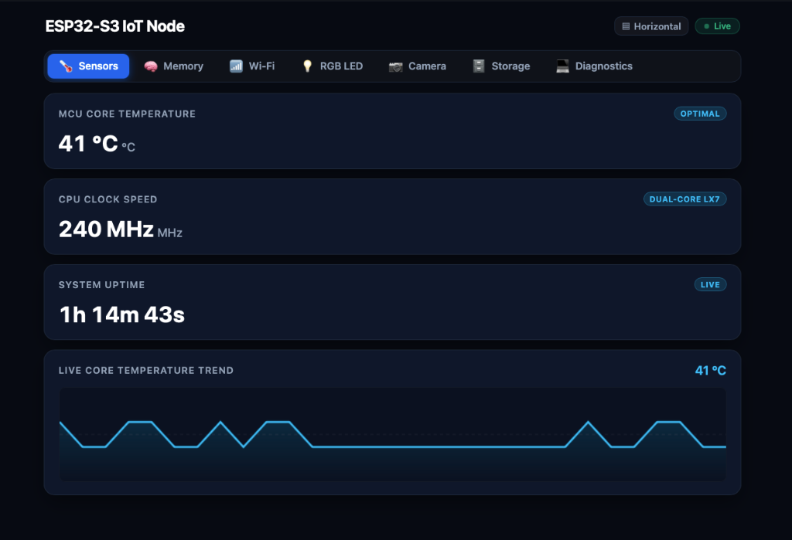
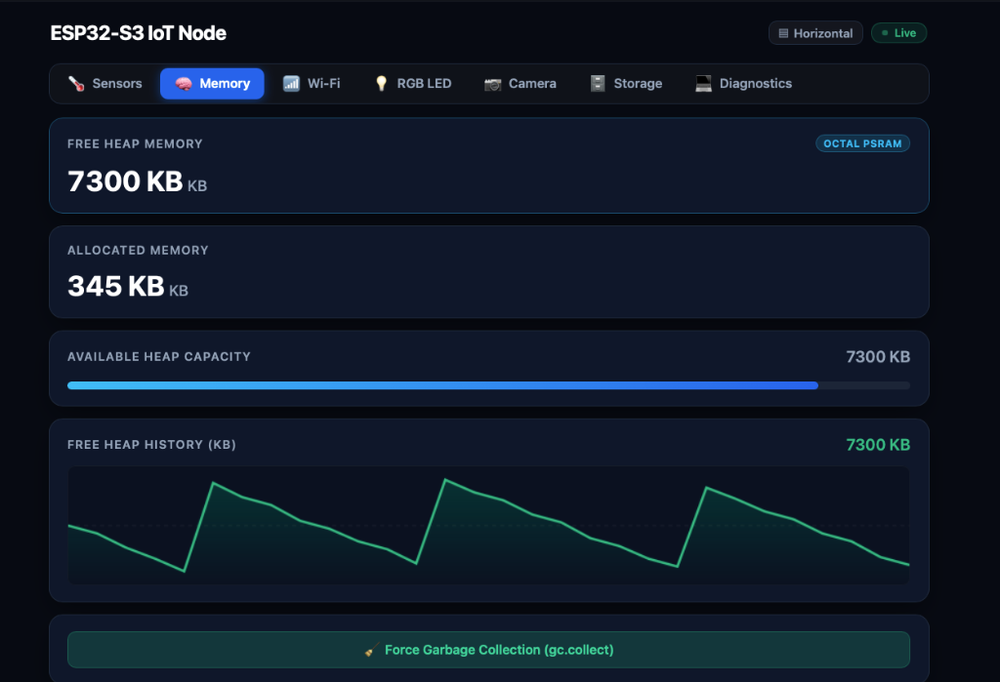
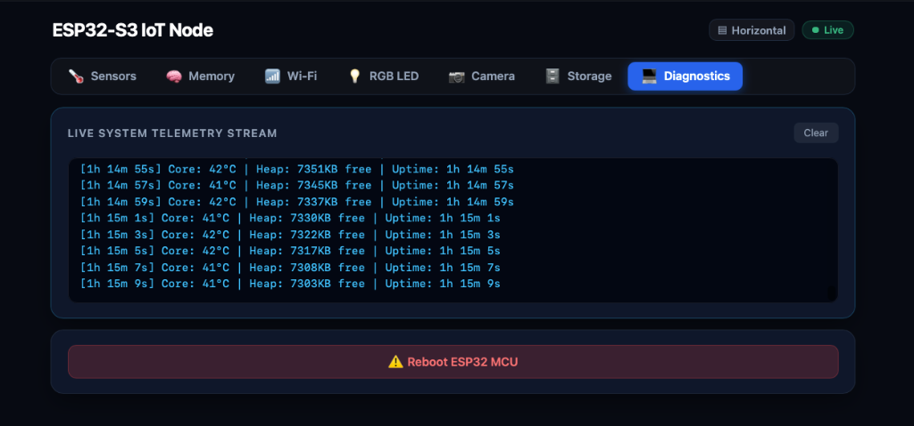

# `espmui`: Modern Reactive Web Dashboard for MicroPython

[](LICENSE)
[](https://micropython.org/)
[]()
[]()
[]()

`espmui` is a lightweight, zero-dependency web dashboard and device manager for **MicroPython** (ESP32, ESP32-S2/S3, ESP32-C3/C6, and Raspberry Pi Pico W).

It pairs a declarative Python API with a pre-gzipped, CDN-free embedded frontend (~13.4 KB) synchronized in real-time over WebSockets.

<p align="center">
  
</p>

<details>
  <summary><b>📷 View More Screenshots (Heap Telemetry & Diagnostics)</b></summary>
  <br>

  #### Memory & GC Tracking
  

  #### Live Telemetry & Terminal Stream
  
</details>

---

## 🚀 Quick Start in 60 Seconds

### Option A: Test on your Desktop (No Hardware Required)
You can test `espmui` directly in Python before plugging in your microcontroller:

```bash
git clone https://github.com/csseeker/espmui.git
cd espmui
python3 -m venv .venv && source .venv/bin/activate
pip install -r requirements-dev.txt

# Run the minimal controls demo locally
python examples/01_minimal_controls.py
```
Open **`http://localhost:80/`** in your browser.

---

### Option B: Deploy to a Physical ESP32

#### 1. Copy `espmui` to your board
Using [`mpremote`](https://docs.micropython.org/en/latest/reference/mpremote.html):
```bash
mpremote fs cp -r src/espmui :
```
*(Or install directly over Wi-Fi on the board via `mip.install("github:csseeker/espmui")`)*.

#### 2. Run your first dashboard
Save this as `main.py` on your ESP32:

```python
import espmui
from machine import Pin
import network

# 1. Connect to local Wi-Fi (or use espmui's Captive Portal)
wlan = network.WLAN(network.STA_IF)
wlan.active(True)
wlan.connect("YOUR_WIFI_SSID", "YOUR_WIFI_PASSWORD")

led = Pin(2, Pin.OUT, value=0)

# 2. Build Dashboard
app = espmui.App(title="ESP32 IoT Dashboard", theme="dark")
tab = app.tab("Controls", icon="sliders")

tab.switch("LED", value=False, on_change=lambda w, val: led.value(1 if val else 0))
tab.slider("Speed", min=0, max=100, step=5, value=25, unit="%", on_change=lambda w, val: print("Speed:", val))
tab.button("Pulse", accent="danger", on_click=lambda w: print("Pulse clicked!"))

# 3. Turnkey System Health Diagnostics & Web OTA Updater
app.enable_diagnostics()
app.enable_ota()

if __name__ == "__main__":
    app.run(port=80)
```

Run it immediately:
```bash
mpremote run main.py
```
Check the serial console for your device IP and navigate to **`http://<ESP32_IP>:80/`**.

---

## ✨ Why `espmui`?

* **No Frontend Toolchain Needed**: Zero npm builds or CDN dependencies. The single-page app (~13.4 KB) is served straight from device flash.
* **Two-Way Reactive Sync**: State changes update connected web clients in real-time (~35 byte WebSocket diffs).
* **Fault-Isolated Execution**: User callback crashes are caught gracefully without breaking the `uasyncio` server loop.
* **Low Footprint (<4 KB RAM during OTA)**: Built with memory-constrained microcontrollers in mind.

---

## 🧰 Turnkey Features

| Feature | Description | Example |
| :--- | :--- | :--- |
| **Core Widgets** | Switches, range sliders, push buttons, metrics, and tab navigation. | [`01_minimal_controls.py`](examples/01_minimal_controls.py) |
| **Sensor Telemetry** | Canvas sparkline charts, metrics, and live camera streaming (OV2640). | [`02_sensor_telemetry.py`](examples/02_sensor_telemetry.py) |
| **Wi-Fi Captive Portal** | SoftAP + DNS interception (`192.168.4.1`) for painless mobile Wi-Fi onboarding. | [`04_wifi_provisioner_portal.py`](examples/04_wifi_provisioner_portal.py) |
| **Persistent Config** | Schema-driven form generator with atomic, corruption-proof `/config.json` saves. | [`05_persistent_config_store.py`](examples/05_persistent_config_store.py) |
| **Live Diagnostics** | Out-of-the-box RAM/heap meters, flash storage usage, manual GC trigger, and soft reboot. | [`06_live_diagnostics.py`](examples/06_live_diagnostics.py) |
| **Web OTA Updater** | Browser drag-and-drop firmware flashing with SHA-256 verification and partition switching. | [`07_web_ota_updater.py`](examples/07_web_ota_updater.py) |

---

## 🧪 Testing & Verification

Unit tests use Python's standard `unittest` module and run standalone without hardware:

```bash
# Run all 62 tests
make test
# or: python3 -m unittest discover -s tests -p "test_*.py"

# Run linter
make lint
# or: ruff check .
```

---

## 📚 Technical References

* [Feature Reference & Deep-Dive Guide](docs/FEATURES.md) — Architectural justifications and component guides.
* [Product & Technical Roadmap](docs/ROADMAP.md) — Phased milestones, priorities, and detailed task breakdowns.
* [Architecture & System Design](docs/architecture.md) — System architecture, component trees, and dataflow.
* [WebSocket Wire Protocol Specification](docs/protocol_spec.md) — JSON opcode schemas, event flows, and diff formats.
* [Concurrency & Resilience Specification](docs/concurrency_and_resilience.md) — Cooperative slicing, backpressure queues, and fault isolation.
