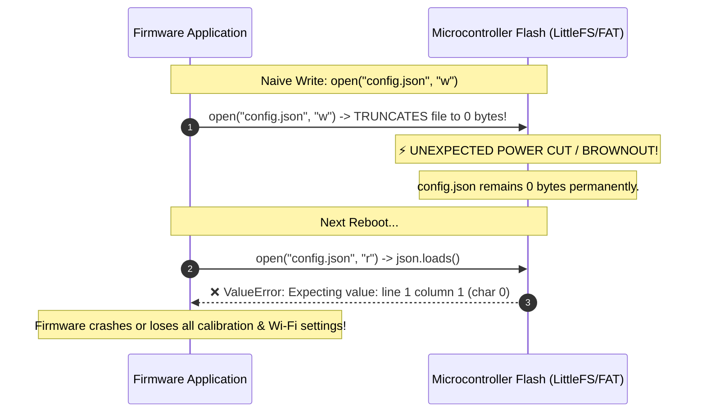
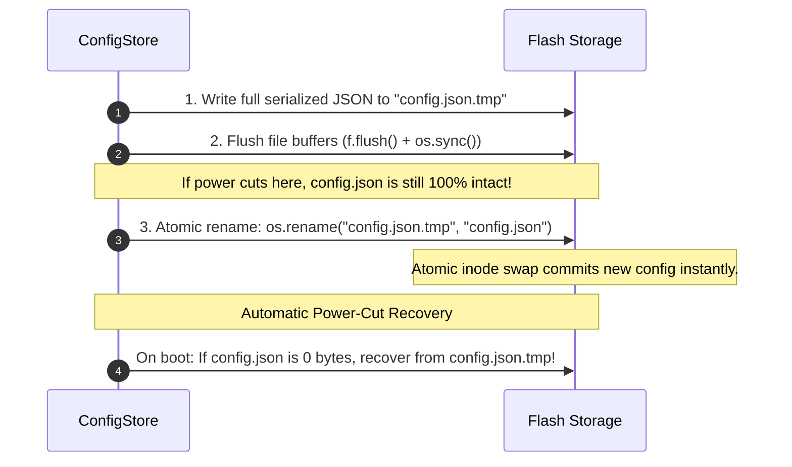
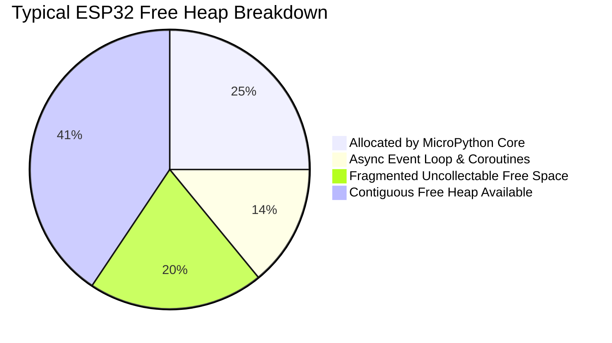
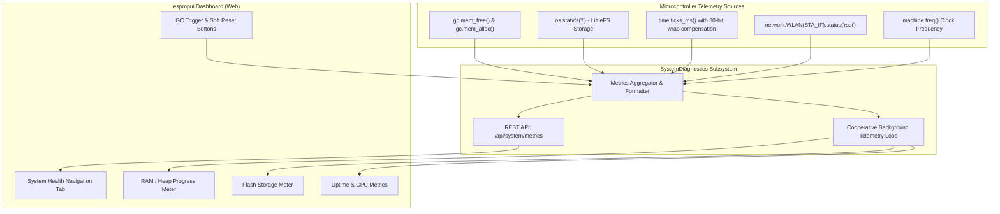
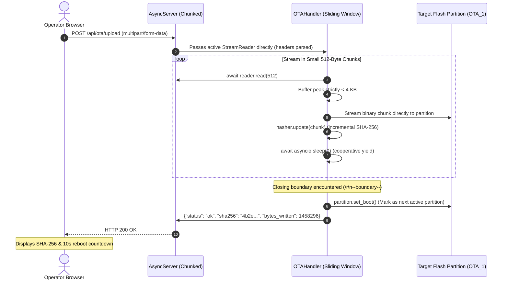

# `espmpui` Feature Reference & Deep-Dive Guide

This document provides in-depth technical references, architecture diagrams, and real-world justifications for each major feature in `espmpui`. Each section documents what the feature does, why it is critical for microcontroller products, the underlying protocols, and how to use it in code.

---

## Table of Contents
- [1. Wi-Fi Provisioner & Captive Portal Subsystem (Milestone 1)](#1-wi-fi-provisioner--captive-portal-subsystem)
  - [1.1. The Real-World Problem Solved](#11-the-real-world-problem-solved)
  - [1.2. The Solution: Dual-Layer Interception](#12-the-solution-dual-layer-interception)
  - [1.3. Technical Architecture & Protocols](#13-technical-architecture--protocols)
  - [1.4. Why You Need Both DNS and HTTP Redirection](#14-why-you-need-both-dns-and-http-redirection)
  - [1.5. Asynchronous Scanner & Resilient Credential Verification](#15-asynchronous-scanner--resilient-credential-verification)
  - [1.6. Mobile-First Frontend View](#16-mobile-first-frontend-view)
  - [1.7. Developer API & Quickstart](#17-developer-api--quickstart)
- [2. Persistent Parameter & Config Store Subsystem (Milestone 2)](#2-persistent-parameter--config-store-subsystem)
  - [2.1. The Real-World Problem: Flash Corruption & Settings Boilerplate](#21-the-real-world-problem-flash-corruption--settings-boilerplate)
  - [2.2. Atomic Flash Persistence Engine (Write-Temp & Rename)](#22-atomic-flash-persistence-engine-write-temp--rename)
  - [2.3. Schema-Driven Form Generation & Type Validation](#23-schema-driven-form-generation--type-validation)
  - [2.4. Python Variable Binding & Reactive Change Hooks](#24-python-variable-binding--reactive-change-hooks)
  - [2.5. Developer API & Quickstart](#25-developer-api--quickstart)
- [3. Live Diagnostics & Telemetry Dashboard Subsystem (Milestone 3)](#3-live-diagnostics--telemetry-dashboard-subsystem)
  - [3.1. The Real-World Problem: Silent MicroPython Heap Fragmentation & Freezes](#31-the-real-world-problem-silent-micropython-heap-fragmentation--freezes)
  - [3.2. Real-Time Telemetry Metrics Architecture](#32-real-time-telemetry-metrics-architecture)
  - [3.3. Out-of-the-Box Maintenance Actions (GC & Soft Reset)](#33-out-of-the-box-maintenance-actions-gc--soft-reset)
  - [3.4. Developer API & Quickstart](#34-developer-api--quickstart)
- [4. Web-Based Drag-and-Drop OTA Updater Subsystem (Milestone 4)](#4-web-based-drag-and-drop-ota-updater-subsystem)
  - [4.1. The Real-World Problem: Physical Tethering & RAM OOM Crashes](#41-the-real-world-problem-physical-tethering--ram-oom-crashes)
  - [4.2. Streaming Multipart Architecture (OOM Avoidance)](#42-streaming-multipart-architecture-oom-avoidance)
  - [4.3. Partition Toggling & Incremental SHA-256 Verification](#43-partition-toggling--incremental-sha-256-verification)
  - [4.4. Frontend UX: Drag-and-Drop, Progress Bar & Reconnection Countdown](#44-frontend-ux-drag-and-drop-progress-bar--reconnection-countdown)
  - [4.5. Developer API & Quickstart](#45-developer-api--quickstart)

---

## 1. Wi-Fi Provisioner & Captive Portal Subsystem

* **Milestone / Tasks**: Milestone 1 (Tasks 1.1, 1.2, 1.3)
* **Modules**: [`src/espmpui/wifi.py`](../src/espmpui/wifi.py), [`src/espmpui/app.py`](../src/espmpui/app.py), [`web/index.html`](../web/index.html)
* **Test Suite**: [`tests/test_wifi.py`](../tests/test_wifi.py)

---

### 1.1. The Real-World Problem Solved

When a user powers on an unconfigured IoT device (e.g., smart sensor, camera node, home controller) out of the box, the microcontroller has no saved Wi-Fi credentials and no internet connection.

#### What happens WITHOUT a Captive Portal:


1. **Requires Technical Knowledge**: Users must know what an IP address is, know the board's gateway IP (`192.168.4.1`), open a browser, and manually type it in.
2. **Cellular Data Hijacking**: iOS and Android detect that the Wi-Fi has no route to the internet and silently route all web traffic over 5G/LTE. When the user types `192.168.4.1`, the phone queries the cellular carrier's network and fails.
3. **OS Auto-Disconnect**: Many phones prompt *"This network has no internet. Disconnect?"* or automatically drop the connection after 15–30 seconds.

---

### 1.2. The Solution: Dual-Layer Interception

Modern operating systems (iOS, Android, macOS, Windows) include built-in captive network detection (the same mechanism used in hotels and airports). `espmpui` coordinates an **RFC 1035 UDP DNS Server** and an **HTTP Probe Redirection Engine**:

```mermaid
sequenceDiagram
    autonumber
    actor User
    participant Phone as Smartphone (iOS / Android)
    participant DNS as Captive DNS (UDP Port 53)
    participant HTTP as HTTP Server (Port 80)

    User->>Phone: Selects "espmpui-Setup"
    Phone->>Phone: Connects to SoftAP (receives IP & DNS=192.168.4.1)
    
    rect rgb(20, 35, 60)
    Note over Phone,DNS: Layer 1: Captive DNS Interception
    Phone->>DNS: UDP: Resolve "captive.apple.com" (or "connectivitycheck.gstatic.com")
    DNS->>Phone: Resolves ANY domain to 192.168.4.1 (A-Record)
    end

    rect rgb(20, 45, 40)
    Note over Phone,HTTP: Layer 2: HTTP Probe Redirection
    Phone->>HTTP: GET /generate_204 (Android) or /hotspot-detect.html (iOS)
    HTTP->>Phone: HTTP 302 Found (Location: http://192.168.4.1/)
    end

    Note over Phone: OS recognizes: "This is an onboarding network!"
    Phone->>HTTP: GET /
    HTTP->>Phone: 200 OK (Serves espmpui Mobile Setup View)
    Phone-->>User: 📱 Auto-pops native setup sheet on screen instantly!
```



---

### 1.3. Technical Architecture & Protocols

#### 1. Layer 1: Asynchronous UDP DNS Interception (`DNSServer`)
- Operates on standard **UDP port 53**.
- Listens non-blocking via cooperative `asyncio` yields (`sleep(0.02)`).
- Parses incoming RFC 1035 query headers, extracts Transaction ID and query Question.
- Synthesizes an authoritative A-Record pointing to `192.168.4.1` with a 60-second TTL:
  - Header: `tx_id + b"\x81\x80\x00\x01\x00\x01\x00\x00\x00\x00"`
  - Answer: `b"\xc0\x0c\x00\x01\x00\x01\x00\x00\x00\x3c\x00\x04" + inet_aton(target_ip)`

#### 2. Layer 2: HTTP Captive Probe Interception (`CaptivePortal`)
- OS probe endpoints intercepted by `AsyncServer`:
  - **Android / ChromeOS**: `/generate_204`, `/gen_204`, `/canonical.html`
  - **Apple (iOS / macOS / iPadOS)**: `/hotspot-detect.html`
  - **Windows**: `/ncsi.txt`, `/connecttest.txt`, `/redirect`
  - **Firefox / Others**: `/mobile/status.php`, `/check_network_status.txt`
- Returns `HTTP 302 Found` with `Location: http://192.168.4.1/`, triggering the OS captive network assistant.

---

### 1.4. Why You Need Both DNS and HTTP Redirection

| Subsystem | What it Does | What Happens if Missing |
| :--- | :--- | :--- |
| **Captive DNS Server** (`UDP :53`) | Intercepts *any* domain resolution query from the phone and returns `192.168.4.1`. | If missing, the phone's DNS query to resolve `connectivitycheck.gstatic.com` or `captive.apple.com` fails at the network layer. The phone never attempts to make an HTTP request to the device. |
| **HTTP Redirection** (`HTTP :80`) | Traps standard OS health-check paths and responds with `HTTP 302 Found`. | If missing (e.g., returns 404 or drops), the phone assumes the Wi-Fi connection is defective and falls back to cellular data. |

---

### 1.5. Asynchronous Scanner & Resilient Credential Verification

Hardware control is managed by `WiFiManager` in [`src/espmpui/wifi.py`](../src/espmpui/wifi.py):

1. **Non-Blocking Network Scanning (`scan_networks()`)**:
   - Calls `sta.scan()` in a cooperative background task.
   - Filters hidden/empty SSIDs.
   - Deduplicates repeating SSIDs (keeps the strongest BSSID signal).
   - Maps raw RSSI decibels into standardized 4-bar signal indicators:
     - $\ge -60\text{ dBm} \to 4\text{ bars}$
     - $\ge -70\text{ dBm} \to 3\text{ bars}$
     - $\ge -80\text{ dBm} \to 2\text{ bars}$
     - $< -80\text{ dBm} \to 1\text{ bar}$

2. **Fault-Tolerant Connection Verification (`connect()`)**:
   - Asynchronously tests credentials against the target router without taking down the SoftAP.
   - If the user mistypes a password, the SoftAP **remains active**, allowing the user to retry immediately without getting permanently locked out or needing to reflash.

3. **REST Provisioning Endpoints**:
   - `GET /api/wifi/scan`: Returns JSON list of discovered networks with signal bars and security status.
   - `POST /api/wifi/connect`: Accepts `{ "ssid": "...", "password": "..." }`, tests the link, and returns `{ "status": "connected", "ip": "192.168.1.100" }` or error diagnostics.
   - `GET /api/wifi/status`: Returns current Wi-Fi status and mode.
   - `GET /setup`: Serves the onboarding bundle directly.

---

### 1.6. Mobile-First Frontend View

The onboarding interface is embedded directly in [`web/index.html`](../web/index.html) and compressed into [`assets.py`](../src/espmpui/assets.py):

* **Smartphone-Optimized**: Designed to fit constrained captive webviews (iOS CNA and Android CaptivePortalLogin).
* **Live Network Selector**: Tap any nearby network to automatically populate the SSID and focus the password field.
* **Touch-Friendly Controls**: Touch targets $\ge 44\text{px}$, password show/hide toggle (`👁️` / `🔒`), and manual SSID entry option.
* **Instant Visual Feedback**:
  - Connecting spinner: *"Connecting to [SSID]... Verifying credentials"*
  - Success banner: Displays assigned IP and instructions on switching back to home Wi-Fi.
  - Failure alert: Clear error reason with retry action.
* **Zero External Dependencies**: Inlined into the 9.8 KB pre-gzipped bundle with zero external CDN scripts or fonts.

---

### 1.7. Developer API & Quickstart

Enabling the captive portal requires **1 line of code** in `espmpui`:

```python
import espmpui

app = espmpui.App(title="IoT Sensor Node", theme="dark")
tab = app.tab("Controls", icon="sliders")
tab.switch("Relay Output", value=False)

# 1. Enable Captive Portal & Wi-Fi Provisioner
# Automatically starts SoftAP, intercepts DNS on port 53, and registers probe redirects.
app.enable_captive_portal(
    ap_ssid="espmpui-Setup",
    ap_password=None,       # Open SoftAP for initial onboarding
    ap_ip="192.168.4.1"     # Standard default gateway
)

if __name__ == "__main__":
    app.run(port=80)
```

#### Complete Working Example:
See [`examples/04_wifi_provisioner_portal.py`](../examples/04_wifi_provisioner_portal.py).

---

## 2. Persistent Parameter & Config Store Subsystem

* **Milestone / Tasks**: Milestone 2 (Tasks 2.1, 2.2, 2.3)
* **Modules**: [`src/espmpui/config.py`](../src/espmpui/config.py), [`src/espmpui/app.py`](../src/espmpui/app.py), [`web/index.html`](../web/index.html)
* **Test Suite**: [`tests/test_config.py`](../tests/test_config.py)

---

### 2.1. The Real-World Problem: Flash Corruption & Settings Boilerplate

Microcontroller projects running in the field (sensors, smart plugs, industrial controllers) frequently experience sudden power disconnects, battery depletion, or watchdog timer resets.

#### The 0-Byte Truncation Hazard:


Additionally, embedded developers spend days writing custom HTML `<form>` tags, parsing URL-encoded POST strings, manually type-casting values, and handling errors for basic settings (e.g. MQTT broker IP, sensor sample rates, calibration offsets).

---

### 2.2. Atomic Flash Persistence Engine (Write-Temp & Rename)

To guarantee that configurations survive sudden power cuts without corruption, `ConfigStore` implements a strict **Write-to-Temp and Atomic Inode Rename** pattern:



---

### 2.3. Schema-Driven Form Generation & Type Validation

Rather than writing custom HTML forms and parsing POST bodies, developers define settings using a declarative Python dictionary schema:

| Field Type | Python Types Accepted | UI Control Generated | Built-in Validations |
| :--- | :--- | :--- | :--- |
| `text` | `str` | Text input box | Required strings, hint caption |
| `number` | `int`, `float` | Number spinner input | Type coercion, `min`, `max`, `step`, `unit` |
| `bool` | `bool` | Animated toggle switch | Boolean type enforcement |
| `select` | `str` | Dropdown selector | Whitelist membership against `options` |
| `slider` | `int`, `float` | Touch range slider | `min`, `max`, `step`, live numeric readout |
| `password` | `str` | Masked text with toggle | Obfuscated input with `👁️` reveal button |

#### Validation Barrier:
- Validation runs whenever a value is updated via Python, REST API, or Web UI.
- If an invalid value is submitted (e.g., `interval = 9999` when `max = 300`), a `ConfigValidationError` is raised, flash write is aborted, and a non-intrusive error toast is broadcast to the browser without crashing the MCU.

---

### 2.4. Python Variable Binding & Reactive Change Hooks

Firmware code accesses settings through direct, idiomatic Python attribute access (`config.sample_rate`), with change hooks that trigger re-configuration on-the-fly:

```python
# Direct variable access
interval = config.sample_rate

# Sync and Async Change Hooks
@config.on_change("target_temp")
def on_temp_change(new_val, old_val):
    print(f"Target temperature changed: {old_val} -> {new_val}")
    thermostat.set_point(new_val)

# Async hook for non-blocking network re-connections
@config.on_change("mqtt_broker")
async def on_broker_change(new_val, old_val):
    await mqtt_client.reconnect(new_val)
```

---

### 2.5. Developer API & Quickstart

Attaching persistent parameters and an automatic web settings form takes **3 lines of code**:

```python
import espmpui

app = espmpui.App(title="IoT Node", theme="dark")

# 1. Define schema & attach atomic storage
config = app.attach_config({
    "device_name": {"type": "text", "default": "Node 1", "label": "Device Name"},
    "sample_rate": {"type": "number", "default": 10, "min": 1, "max": 300, "unit": "s", "label": "Polling Interval"},
    "alarm_enabled": {"type": "bool", "default": True, "label": "Alarm Buzzer"},
    "operating_mode": {"type": "select", "options": ["NORMAL", "ECO", "BOOST"], "default": "NORMAL", "label": "Mode"}
}, filepath="config.json")

# 2. Add automatic schema-driven form to a tab
tab = app.tab("Settings", icon="sliders")
tab.config_form(config, label="System Settings")

# 3. Access variables directly in hardware loops
@config.on_change("sample_rate")
def on_interval_changed(new_val, old_val):
    print(f"Sampling interval updated to {new_val}s")

if __name__ == "__main__":
    app.run(port=80)
```

#### Complete Working Example:
See [`examples/05_persistent_config_store.py`](../examples/05_persistent_config_store.py).

---

## 3. Live Diagnostics & Telemetry Dashboard Subsystem

* **Milestone / Tasks**: Milestone 3 (Tasks 3.1, 3.2)
* **Modules**: [`src/espmpui/diagnostics.py`](../src/espmpui/diagnostics.py), [`src/espmpui/app.py`](../src/espmpui/app.py), [`web/index.html`](../web/index.html)
* **Test Suite**: [`tests/test_diagnostics.py`](../tests/test_diagnostics.py)

---

### 3.1. The Real-World Problem: Silent MicroPython Heap Fragmentation & Freezes

MicroPython executes within a limited, garbage-collected heap (typically only 100 KB to 300 KB on standard ESP32 boards without external PSRAM).



#### Why MicroPython Nodes Randomly Freeze:
1. **Gradual Memory Leaks**: Coroutines that retain unclosed sockets or append to unbounded lists gradually exhaust free heap over hours or days.
2. **Heap Fragmentation**: Repeated string slicing and large dictionary allocations create "swiss cheese" fragmentation where plenty of total bytes are free, but `allocate` fails because no contiguous block exists.
3. **No Serial Cable in the Field**: Once an IoT node is deployed inside an electrical box, ceiling, or agricultural field, plugging in a USB cable to run `gc.mem_free()` is impossible.

---

### 3.2. Real-Time Telemetry Metrics Architecture

`SystemDiagnostics` aggregates core system health without external dependencies:



1. **Heap Allocation Tracking**: Reports allocated bytes, free bytes, and percentage free with zero task thrashing.
2. **Filesystem Flash Storage**: Queries `os.statvfs('/')` to track LittleFS/FAT storage block usage and prevent flash-full crashes.
3. **Rollover-Safe Uptime**: Calculates elapsed system uptime safely handling MicroPython 30-bit signed integer tick overflows (`time.ticks_diff()`).
4. **Wi-Fi Signal Strength**: Live RSSI dBm readout to spot signal degradation before devices drop offline.

---

### 3.3. Out-of-the-Box Maintenance Actions (GC & Soft Reset)

The System Health tab provides two administrative controls:

- **🧹 Manual Garbage Collection**:
  - Triggers `gc.collect()`, computes exact freed memory (`after - before`), updates the RAM meter immediately, and displays a toast (e.g., `GC Complete: 12,480 bytes freed`).
- **⚡ Safe Soft Restart**:
  - Responds to the client with `200 OK` first, flushes HTTP/WebSocket sockets cleanly, and invokes `machine.reset()` after a brief cooperative delay (`asyncio.sleep_ms(800)`), avoiding socket corruption or browser hangs.

---

### 3.4. Developer API & Quickstart

Enabling live diagnostics requires **1 line of code**:

```python
import espmpui

app = espmpui.App(title="Solar Monitor", theme="dark")
tab = app.tab("Controls", icon="sliders")
tab.switch("Inverter Power", value=True)

# 1. Enable System Diagnostics
# Automatically creates the "System Health" tab with live meters and maintenance actions.
diag = app.enable_diagnostics(title="System Health", icon="cpu", start_loop=True)

if __name__ == "__main__":
    app.run(port=80)
```

#### Complete Working Example:
See [`examples/06_live_diagnostics.py`](../examples/06_live_diagnostics.py).

---

## 4. Web-Based Drag-and-Drop OTA Updater Subsystem

* **Milestone / Tasks**: Milestone 4 (Tasks 4.1, 4.2)
* **Modules**: [`src/espmpui/ota.py`](../src/espmpui/ota.py), [`src/espmpui/app.py`](../src/espmpui/app.py), [`web/index.html`](../web/index.html)
* **Test Suite**: [`tests/test_ota.py`](../tests/test_ota.py)

---

### 4.1. The Real-World Problem: Physical Tethering & RAM OOM Crashes

In commercial IoT and edge hardware deployments, devices are often installed in ceiling mounts, waterproof junction boxes, agriculture fields, or customer premises where attaching a physical USB cable and running `esptool.py` is impossible or cost-prohibitive.

However, implementing web-based OTA on resource-constrained microcontrollers introduces severe engineering challenges:

1. **Catastrophic Out-Of-Memory (OOM) Crashes**:
   - ESP32 microcontrollers typically have ~320 KB SRAM with 100 KB–200 KB free heap in MicroPython.
   - Compiled firmware binaries and filesystem images are typically **1 MB to 3 MB**.
   - Traditional web framework handlers that buffer the incoming HTTP POST body in memory (`await reader.read()` or `request.body()`) crash the MCU with an immediate `MemoryError` within the first few packets, before even 5% of the file arrives.

2. **Flash Corruption / Device Bricking**:
   - If an OTA flasher begins writing bytes to flash without validating that the stream is complete and intact, a network timeout or premature disconnect leaves the flash partition half-written.
   - If the device attempts to boot into a half-written partition, it enters a boot loop (`crash / panic`).

3. **User Anxiety & Accidental Power Interruption**:
   - Flashing firmware takes between 15 and 45 seconds over Wi-Fi.
   - Without real-time upload progress, explicit risk warnings, and clear reconnection countdowns, users assume the browser has hung, close the tab, or power-cycle the board mid-write.

---

### 4.2. Streaming Multipart Architecture (OOM Avoidance)

`espmpui` solves the RAM ceiling through a **zero-buffering streaming sliding window engine**:



#### Key Architecture Principles:
1. **Direct Socket-to-Flash Streaming**: Reads fixed-size chunks (default: 512 bytes). The sliding window buffer stays strictly under 4 KB at all times.
2. **Boundary Delimiter Tracking**: Detects the trailing multipart delimiter (`\r\n--` + boundary) across chunk boundaries by writing only bytes outside the trailing delimiter window.
3. **Cooperative Multitasking Yield**: Yields execution with `await asyncio.sleep(0)` between chunks so the network stack and background tasks don't starve or drop packets.

---

### 4.3. Partition Toggling & Incremental SHA-256 Verification

ESP32 dual-OTA partitioning provides hardware-level rollback safety:
- **Partition Discovery**: Automatically queries `esp32.Partition(esp32.Partition.RUNNING).get_next_update()`. If running on `ota_0`, updates target `ota_1` (and vice-versa).
- **Incremental SHA-256 Checksum**: Employs `hashlib.sha256()` across each streamed chunk as it arrives, computing the final digest without ever keeping the full payload in RAM.
- **Atomic Boot Switch**: `partition.set_boot()` is **only** invoked if the entire file was streamed successfully with a non-zero payload. If the stream is truncated or malformed, the boot partition remains untouched and safe.

---

### 4.4. Frontend UX: Drag-and-Drop, Progress Bar & Reconnection Countdown

The embedded frontend provides a consumer-grade OTA dialog:

1. **Interactive Dropzone**: Drag-and-drop or file browser supporting `.bin` firmware files.
2. **Active Partition Badges**: Displays current running partition (`Active Boot: ota_0`) and target partition (`Target Flash: ota_1`).
3. **Flashing Hazard Warning**: Prominent amber alert during flashing: *"⚠️ Flashing in Progress: DO NOT disconnect power or close this browser window."*
4. **Live Progress Tracking**: Uses `XMLHttpRequest.upload.onprogress` to display percentage, animated progress bar fill, and uploaded/total KB counters.
5. **Post-Reboot Reconnect Countdown**: Displays computed SHA-256 checksum and a 10-second automatic reconnection timer before automatically refreshing the dashboard.

---

### 4.5. Developer API & Quickstart

Enabling web-based OTA in `espmpui` requires **1 line of code**:

```python
import espmpui

app = espmpui.App(title="S3 Sensor Gateway", theme="dark")

# 1. Enable Drag-and-Drop Web OTA Updater
# Attaches /api/ota/status, /api/ota/upload, and the top-navigation OTA dialog
ota = app.enable_ota()

if __name__ == "__main__":
    app.run(port=80)
```

#### Complete Working Example:
See [`examples/07_web_ota_updater.py`](../examples/07_web_ota_updater.py).

---

## 5. Disclaimer & Warranty

This project is open-source software provided under the [MIT License](../LICENSE).

> **Disclaimer**: This software and accompanying documentation are provided **"as is"**, without warranty of any kind, express or implied, including but not limited to warranties of merchantability, fitness for a particular purpose, non-infringement, or hardware operation. In no event shall the authors or copyright holders be liable for any claim, damages, data loss, device bricking, or other liability arising from the use of this software. Users are solely responsible for verifying hardware wiring, electrical safety, and OTA firmware compatibility prior to deployment.
