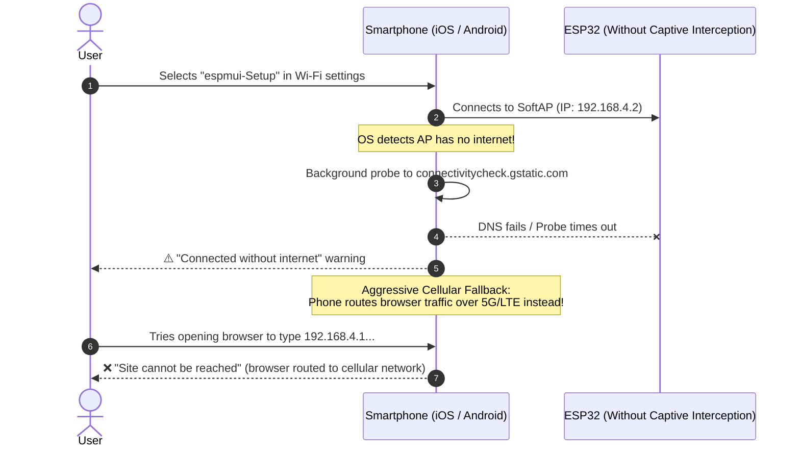

# `espmui` Feature Reference & Deep-Dive Guide

This document provides in-depth technical references, architecture diagrams, and real-world justifications for each major feature in `espmui`. Each section documents what the feature does, why it is critical for microcontroller products, the underlying protocols, and how to use it in code.

---

## Table of Contents
- [1. Wi-Fi Provisioner & Captive Portal Subsystem (Milestone 1)](#1-wi-fi-provisioner--captive-portal-subsystem)
  - [1.1. The Real-World Problem Solved](#11-the-real-world-problem-solved)
  - [1.2. The Solution: Dual-Layer Interception](#12-the-solution-dual-layer-interception)
  - [1.3. Technical Architecture & Protocols](#13-technical-architecture--protocols)
  - [1.4. Why You Need Both DNS and HTTP Redirection](#14-why-you-need-both-dns-and-http-redirection)
  - [1.5. Asynchronous Scanner & Resilient Credential Verification](#15-asynchronous-scanner--resilient-credential-verification)
  - [1.6. Mobile-First Frontend View](#16-mobile-first-frontend-view)
  - [1.7. Developer API & Quickstart](#17-developer-api--quickstart)

---

## 1. Wi-Fi Provisioner & Captive Portal Subsystem

* **Milestone / Tasks**: Milestone 1 (Tasks 1.1, 1.2, 1.3)
* **Modules**: [`src/espmui/wifi.py`](../src/espmui/wifi.py), [`src/espmui/app.py`](../src/espmui/app.py), [`web/index.html`](../web/index.html)
* **Test Suite**: [`tests/test_wifi.py`](../tests/test_wifi.py)

---

### 1.1. The Real-World Problem Solved

When a user powers on an unconfigured IoT device (e.g., smart sensor, camera node, home controller) out of the box, the microcontroller has no saved Wi-Fi credentials and no internet connection.

#### What happens WITHOUT a Captive Portal:


1. **Requires Technical Knowledge**: Users must know what an IP address is, know the board's gateway IP (`192.168.4.1`), open a browser, and manually type it in.
2. **Cellular Data Hijacking**: iOS and Android detect that the Wi-Fi has no route to the internet and silently route all web traffic over 5G/LTE. When the user types `192.168.4.1`, the phone queries the cellular carrier's network and fails.
3. **OS Auto-Disconnect**: Many phones prompt *"This network has no internet. Disconnect?"* or automatically drop the connection after 15–30 seconds.

---

### 1.2. The Solution: Dual-Layer Interception

Modern operating systems (iOS, Android, macOS, Windows) include built-in captive network detection (the same mechanism used in hotels and airports). `espmui` coordinates an **RFC 1035 UDP DNS Server** and an **HTTP Probe Redirection Engine**:


---

### 1.3. Technical Architecture & Protocols

#### 1. Layer 1: Asynchronous UDP DNS Interception (`DNSServer`)
- Operates on standard **UDP port 53**.
- Listens non-blocking via cooperative `asyncio` yields (`sleep(0.02)`).
- Parses incoming RFC 1035 query headers, extracts Transaction ID and query Question.
- Synthesizes an authoritative A-Record pointing to `192.168.4.1` with a 60-second TTL:
  - Header: `tx_id + b"\x81\x80\x00\x01\x00\x01\x00\x00\x00\x00"`
  - Answer: `b"\xc0\x0c\x00\x01\x00\x01\x00\x00\x00\x3c\x00\x04" + inet_aton(target_ip)`

#### 2. Layer 2: HTTP Captive Probe Interception (`CaptivePortal`)
- OS probe endpoints intercepted by `AsyncServer`:
  - **Android / ChromeOS**: `/generate_204`, `/gen_204`, `/canonical.html`
  - **Apple (iOS / macOS / iPadOS)**: `/hotspot-detect.html`
  - **Windows**: `/ncsi.txt`, `/connecttest.txt`, `/redirect`
  - **Firefox / Others**: `/mobile/status.php`, `/check_network_status.txt`
- Returns `HTTP 302 Found` with `Location: http://192.168.4.1/`, triggering the OS captive network assistant.

---

### 1.4. Why You Need Both DNS and HTTP Redirection

| Subsystem | What it Does | What Happens if Missing |
| :--- | :--- | :--- |
| **Captive DNS Server** (`UDP :53`) | Intercepts *any* domain resolution query from the phone and returns `192.168.4.1`. | If missing, the phone's DNS query to resolve `connectivitycheck.gstatic.com` or `captive.apple.com` fails at the network layer. The phone never attempts to make an HTTP request to the device. |
| **HTTP Redirection** (`HTTP :80`) | Traps standard OS health-check paths and responds with `HTTP 302 Found`. | If missing (e.g., returns 404 or drops), the phone assumes the Wi-Fi connection is defective and falls back to cellular data. |

---

### 1.5. Asynchronous Scanner & Resilient Credential Verification

Hardware control is managed by `WiFiManager` in [`src/espmui/wifi.py`](../src/espmui/wifi.py):

1. **Non-Blocking Network Scanning (`scan_networks()`)**:
   - Calls `sta.scan()` in a cooperative background task.
   - Filters hidden/empty SSIDs.
   - Deduplicates repeating SSIDs (keeps the strongest BSSID signal).
   - Maps raw RSSI decibels into standardized 4-bar signal indicators:
     - $\ge -60\text{ dBm} \to 4\text{ bars}$
     - $\ge -70\text{ dBm} \to 3\text{ bars}$
     - $\ge -80\text{ dBm} \to 2\text{ bars}$
     - $< -80\text{ dBm} \to 1\text{ bar}$

2. **Fault-Tolerant Connection Verification (`connect()`)**:
   - Asynchronously tests credentials against the target router without taking down the SoftAP.
   - If the user mistypes a password, the SoftAP **remains active**, allowing the user to retry immediately without getting permanently locked out or needing to reflash.

3. **REST Provisioning Endpoints**:
   - `GET /api/wifi/scan`: Returns JSON list of discovered networks with signal bars and security status.
   - `POST /api/wifi/connect`: Accepts `{ "ssid": "...", "password": "..." }`, tests the link, and returns `{ "status": "connected", "ip": "192.168.1.100" }` or error diagnostics.
   - `GET /api/wifi/status`: Returns current Wi-Fi status and mode.
   - `GET /setup`: Serves the onboarding bundle directly.

---

### 1.6. Mobile-First Frontend View

The onboarding interface is embedded directly in [`web/index.html`](../web/index.html) and compressed into [`assets.py`](../src/espmui/assets.py):

* **Smartphone-Optimized**: Designed to fit constrained captive webviews (iOS CNA and Android CaptivePortalLogin).
* **Live Network Selector**: Tap any nearby network to automatically populate the SSID and focus the password field.
* **Touch-Friendly Controls**: Touch targets $\ge 44\text{px}$, password show/hide toggle (`👁️` / `🔒`), and manual SSID entry option.
* **Instant Visual Feedback**:
  - Connecting spinner: *"Connecting to [SSID]... Verifying credentials"*
  - Success banner: Displays assigned IP and instructions on switching back to home Wi-Fi.
  - Failure alert: Clear error reason with retry action.
* **Zero External Dependencies**: Inlined into the 9.8 KB pre-gzipped bundle with zero external CDN scripts or fonts.

---

### 1.7. Developer API & Quickstart

Enabling the captive portal requires **1 line of code** in `espmui`:

```python
import espmui

app = espmui.App(title="IoT Sensor Node", theme="dark")
tab = app.tab("Controls", icon="sliders")
tab.switch("Relay Output", value=False)

# 1. Enable Captive Portal & Wi-Fi Provisioner
# Automatically starts SoftAP, intercepts DNS on port 53, and registers probe redirects.
app.enable_captive_portal(
    ap_ssid="espmui-Setup",
    ap_password=None,       # Open SoftAP for initial onboarding
    ap_ip="192.168.4.1"     # Standard default gateway
)

if __name__ == "__main__":
    app.run(port=80)
```

#### Complete Working Example:
See [`examples/04_wifi_provisioner_portal.py`](../examples/04_wifi_provisioner_portal.py).
