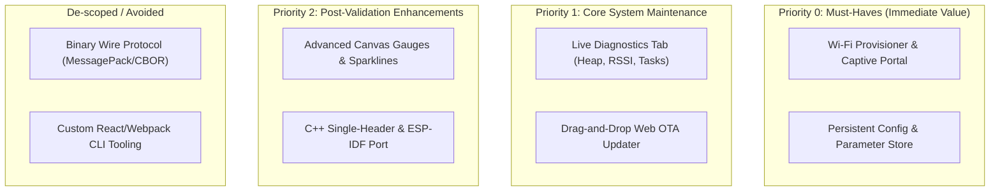
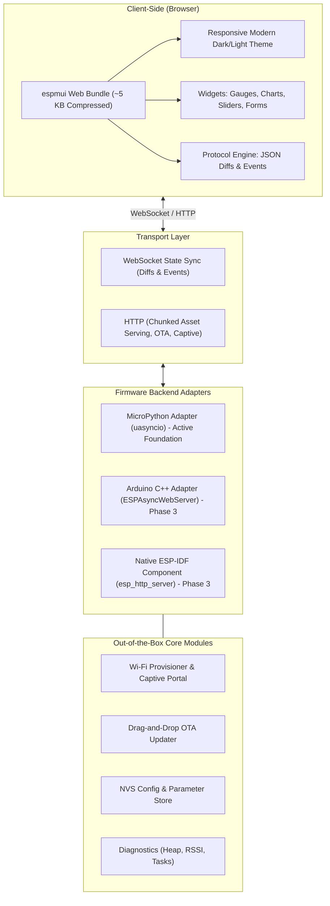
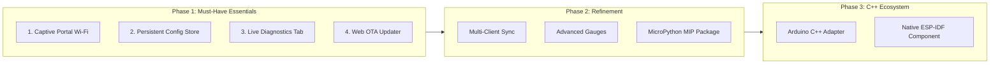

# `espmui` Pragmatic Product Roadmap & Action Plan

## 1. Value Proposition & Strategic Focus

### The Core Problem
Every microcontroller product (sensors, home automation, industrial nodes) requires local network provisioning, persistent configuration, and real-time operational telemetry. Today, developers face an agonizing choice:
- **Raw HTML Forms:** 1990s aesthetic, full-page refreshes on every interaction, zero reactive feedback.
- **Heavyweight Frameworks (ESPHome/Tasmota):** Gorgeous UIs, but they monopolize the entire firmware and cannot be embedded as a lightweight component into custom code.
- **React/Vue SPAs:** Hundreds of kilobytes, requiring Node/npm build pipelines that embedded developers avoid, frequently crashing MCU heaps.

### `espmui`'s Unique Value Proposition (UVP)
> **"A modern, reactive, app-like Web UI for MicroPython in under 15 lines of code — using ~5 KB flash, under 8 KB RAM, and zero frontend build tools."**

*For the complete persona breakdown, user journeys, and feature evaluation rules, see [Value Proposition & User Personas](VALUE_PROPOSITION.md).*

---

## 2. Strategic Scoping & Rationale

We explicitly categorize capabilities into **Immediate Must-Haves**, **Secondary Enhancements**, and **Deprioritized Distractions**:

### Why Focus on MicroPython First?
1. **Uncontested Niche:** There is virtually no modern, responsive Web UI library built specifically for MicroPython on ESP32 / Pico W.
2. **Speed of Execution:** MicroPython provides rapid iteration on widget schemas, reactive mechanics, and UX without long compile-flash-debug cycles.
3. **Single Source of Truth:** Locking down the UX, wire protocol, and module contracts in MicroPython first guarantees that any subsequent C++/ESP-IDF port will be clean and battle-tested.

### Why Deprioritize Binary Protocol & React CLI?
- **JSON Diffs are fast enough:** State diffs are ~30–50 bytes. For 1–10 Hz updates, JSON is negligible for the CPU and offers a massive advantage: **it is trivially debugged via browser DevTools**.
- **Embedded devs want zero-Node:** Custom frontend build pipelines appeal only to web developers who would build their own SPAs anyway. Our core customer wants a pre-packaged, zero-dependency dashboard.

---

## 3. Architecture Overview

---

## 4. Phased Roadmap

---

## 5. Detailed Justifications & Actionable Work Items

### ✅ Completed Foundation (v0.1.0)

- [x] **Core: Asynchronous HTTP & RFC 6455 WebSocket Server** (`AsyncServer` with chunked asset delivery, cooperative `sleep_ms(0)` yields).
- [x] **Core: Declarative Python Widget Hierarchy** (`Button`, `Switch`, `Slider`, `Metric`, `Progress`).
- [x] **Resilience: Fault-Isolated Event Dispatch Barrier** (Traps exceptions in user callbacks without crashing the main loop or rebooting chip).
- [x] **Frontend: Embedded Single-Page App** (~4.7 KB pre-gzipped bundle, zero external CDN dependencies, mobile-responsive dark theme).
- [x] **IoT Suite: Specialized Widgets** (Real-time HTML5 Canvas Sparkline, Web Terminal log monitor, Flash File Explorer, Camera Viewfinder).

---

### 📌 Milestone 1: Wi-Fi Provisioner & Captive Portal (Priority: P0)
*Target: Eliminate hardcoded Wi-Fi credentials and provide instant zero-friction onboarding.*

- [ ] **Task 1.1: SoftAP & DNS Captive Redirection Server**
  * **Why do we need it:** Without DNS interception (`port 53`), connecting to an unconfigured device AP displays an annoying "Connected without internet" warning on phones and silently fails to prompt the user. Captive redirection intercepts standard probe requests (`/generate_204` for Android, `/hotspot-detect.html` for iOS/macOS, `/ncsi.txt` for Windows) and instantly pops up the setup page on the user's screen without requiring them to know or type `192.168.4.1`.
  * **When & Where is it useful:** First-time out-of-the-box unboxing, relocation to a new room/site, or recovering from router password changes.
  * **How often is it needed:** Low runtime frequency (1–2x per device lifecycle), but **Critical (P0 gatekeeper)**: if onboarding fails, non-technical users cannot use the device.

- [ ] **Task 1.2: Asynchronous Wi-Fi Scanner & Credential Handler**
  * **Why do we need it:** Typing 24-character hex Wi-Fi passwords and exact SSIDs on mobile touchscreens is error-prone. Background scanning lists nearby networks with visual RSSI signal bars so users just tap their SSID. Asynchronously testing the connection before tearing down SoftAP prevents "bricking" connectivity if the user mistypes credentials.
  * **When & Where is it useful:** Directly inside the onboarding captive portal flow on the user's mobile or laptop browser.
  * **How often is it needed:** Every time the device is provisioned or reconfigured.

- [ ] **Task 1.3: Captive Portal Mobile-First Frontend View**
  * **Why do we need it:** Over 95% of captive setups happen from smartphones. Standard desktop dashboards are cramped and hard to navigate on phones. A dedicated, clean, single-purpose mobile onboarding dialog ensures immediate clarity and confidence.
  * **When & Where is it useful:** Rendered immediately when the mobile OS captive sheet opens.
  * **How often is it needed:** Whenever entering setup/provisioning mode.

---

### 📌 Milestone 2: Persistent Parameter & Config Store (Priority: P0)
*Target: Enable settings that persist across power cycles without custom file parsing code.*

- [ ] **Task 2.1: Schema-Driven Form Generation**
  * **Why do we need it:** Firmware developers typically spend days writing custom HTML forms, parsing POST bodies, and validating string inputs for application settings (e.g. MQTT broker IP, sensor sample interval, alarm thresholds, motor PID gains). A schema-driven generator creates styled, validated inputs (numeric ranges, dropdowns, toggles) automatically from a simple Python dictionary.
  * **When & Where is it useful:** In every commercial IoT product requiring runtime customization (calibrations, URLs, tokens), and during lab/field testing to tune parameters without re-flashing firmware.
  * **How often is it needed:** Initial commissioning and periodically as operating conditions change or calibration is needed (weekly to monthly).

- [ ] **Task 2.2: Atomic Flash Persistence Layer (`/config.json`)**
  * **Why do we need it:** Microcontrollers frequently experience unexpected power cuts, brownouts, or watchdog reboots. Naive file writes (`open('config.json', 'w')`) truncate files upon opening; if power cuts during the write, the file is corrupted to 0 bytes, permanently losing all settings. An atomic write-to-temp and rename pattern (`config.tmp` $\to$ `config.json`) guarantees data integrity under all power failure conditions.
  * **When & Where is it useful:** Whenever any configuration variable is updated via the web interface or programmatically from Python.
  * **How often is it needed:** Invoked on every settings save. While write frequency is moderate to protect flash endurance, bulletproof reliability is **mandatory**.

- [ ] **Task 2.3: Python Variable Binding & Change Hooks**
  * **Why do we need it:** Embedded code needs direct, idiomatic access to configuration values (e.g., `app.config.sample_rate`) without manual JSON parsing. Change hooks allow firmware to immediately reconfigure hardware (e.g. updating PWM frequency or reconnecting MQTT) without requiring a full device reboot.
  * **When & Where is it useful:** Throughout main application code and background sensor loops.
  * **How often is it needed:** Read continuously during startup and main loops; hooks trigger whenever the user modifies a setting.

---

### 📌 Milestone 3: Live Diagnostics & Telemetry Dashboard (Priority: P1)
*Target: Provide immediate system health visibility for monitoring and debugging without a serial cable.*

- [ ] **Task 3.1: Built-in System Metrics Collector**
  * **Why do we need it:** MicroPython runs in a garbage-collected heap (often as small as 100–300 KB). Heap fragmentation and gradual memory leaks are the #1 reasons MicroPython devices mysteriously freeze after days of operation. Live metrics tracking of `gc.mem_free()`, `gc.mem_alloc()`, Wi-Fi RSSI, and uptime lets engineers spot memory leaks and poor Wi-Fi reception instantly.
  * **When & Where is it useful:** Bench testing coroutine leaks and GC behavior during development; troubleshooting field devices in hard-to-reach locations (ceilings, waterproof boxes, remote poles) where plugging in a USB cable is impossible.
  * **How often is it needed:** Continuously collected at 1 Hz only while an operator has the diagnostics tab open. Suspends collection when inactive to conserve CPU and RAM.

- [ ] **Task 3.2: Diagnostics Tab in UI**
  * **Why do we need it:** Provides an out-of-the-box "System" tab requiring zero setup lines by the developer. Includes visual RAM meters, Wi-Fi signal gauge, uptime counter, and actionable maintenance controls (manual GC trigger, soft reboot button, flash storage usage).
  * **When & Where is it useful:** Available on every `espmui` dashboard out of the box as an administrative view.
  * **How often is it needed:** Regularly during development and debugging sessions; on-demand during maintenance checks.

---

### 📌 Milestone 4: Web-Based Drag-and-Drop OTA Updater (Priority: P1)
*Target: Eliminate USB cable tethering for firmware updates.*

- [ ] **Task 4.1: Streaming Multipart File Upload Handler**
  * **Why do we need it:** ESP32 boards have very limited RAM (typically 320 KB SRAM without external PSRAM). A firmware binary or filesystem image is typically 1 MB to 3 MB. Attempting to buffer the uploaded file in RAM causes an immediate Out-Of-Memory (OOM) crash. A chunked streaming handler reads incoming HTTP multipart streams in small 512–1024 byte buffers and streams them directly into the inactive OTA flash partition.
  * **When & Where is it useful:** When updating deployed devices in consumer homes, agricultural fields, or industrial ceilings without unplugging/replugging physical cables.
  * **How often is it needed:** Occasional (firmware release cycles); mandatory prerequisite for any commercially deployable IoT product.

- [ ] **Task 4.2: Frontend Upload Dialog & Progress Bar**
  * **Why do we need it:** Flashing firmware is high-risk. If a user closes the browser mid-upload or doesn't know if the board is still flashing, they might power-cycle the board mid-write. A clear modal with upload percentage, byte counter, SHA-256 verification indicator, and automatic post-reboot reconnect countdown prevents user panic and corrupted flash states.
  * **When & Where is it useful:** Integrated into the System / Settings tab of the dashboard.
  * **How often is it needed:** Every time a firmware update is executed.
