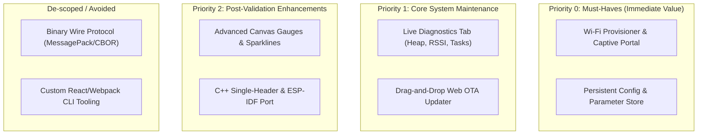
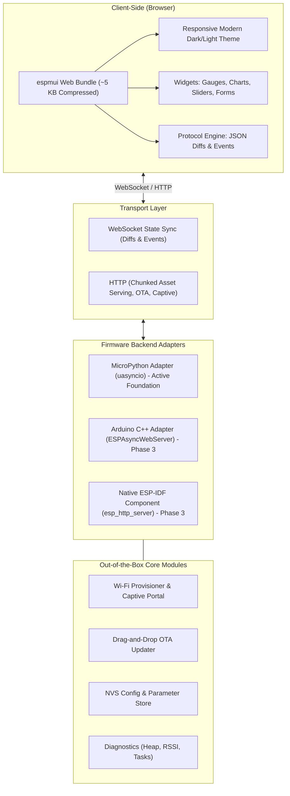
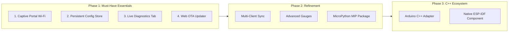

# `espmui` Pragmatic Product Roadmap & Action Plan

## 1. Value Proposition & Strategic Focus

### The Core Problem
Every microcontroller product (sensors, home automation, industrial nodes) requires local network provisioning, persistent configuration, and real-time operational telemetry. Today, developers face an agonizing choice:
- **Raw HTML Forms:** 1990s aesthetic, full-page refreshes on every interaction, zero reactive feedback.
- **Heavyweight Frameworks (ESPHome/Tasmota):** Gorgeous UIs, but they monopolize the entire firmware and cannot be embedded as a lightweight component into custom code.
- **React/Vue SPAs:** Hundreds of kilobytes, requiring Node/npm build pipelines that embedded developers avoid, frequently crashing MCU heaps.

### `espmui`'s Unique Value Proposition (UVP)
> **"A modern, reactive, app-like Web UI for MicroPython in under 15 lines of code — using ~5 KB flash, under 8 KB RAM, and zero frontend build tools."**

---

## 2. Strategic Scoping & Rationale

We explicitly categorize capabilities into **Immediate Must-Haves**, **Secondary Enhancements**, and **Deprioritized Distractions**:

### Why Focus on MicroPython First?
1. **Uncontested Niche:** There is virtually no modern, responsive Web UI library built specifically for MicroPython on ESP32 / Pico W.
2. **Speed of Execution:** MicroPython provides rapid iteration on widget schemas, reactive mechanics, and UX without long compile-flash-debug cycles.
3. **Single Source of Truth:** Locking down the UX, wire protocol, and module contracts in MicroPython first guarantees that any subsequent C++/ESP-IDF port will be clean and battle-tested.

### Why Deprioritize Binary Protocol & React CLI?
- **JSON Diffs are fast enough:** State diffs are ~30–50 bytes. For 1–10 Hz updates, JSON is negligible for the CPU and offers a massive advantage: **it is trivially debugged via browser DevTools**.
- **Embedded devs want zero-Node:** Custom frontend build pipelines appeal only to web developers who would build their own SPAs anyway. Our core customer wants a pre-packaged, zero-dependency dashboard.

---

## 3. Architecture Overview

---

## 4. Phased Roadmap

---

## 5. Actionable Work Items (Must-Haves)

### 📌 Milestone 1: Wi-Fi Provisioner & Captive Portal (Priority: P0)
*Eliminate hardcoded Wi-Fi credentials and provide instant zero-friction device setup.*

- [ ] **Task 1.1: SoftAP & DNS Captive Redirection Server**
  - Implement a lightweight DNS server (`port 53`) intercepting all queries and redirecting to `192.168.4.1`.
  - Handle OS captive detection endpoints (`/generate_204` for Android, `/hotspot-detect.html` for Apple, `/ncsi.txt` for Windows).
- [ ] **Task 1.2: Asynchronous Wi-Fi Scanner & Credential Handler**
  - Background scanning of available SSIDs with RSSI signal metrics and auth types.
  - Safe credential validation: Test connection to target AP before disabling SoftAP.
- [ ] **Task 1.3: Captive Portal Frontend View**
  - Ultra-clean mobile-first onboarding screen embedded directly into the bundle.
  - One-click network selection, password input, and visual connection status.

---

### 📌 Milestone 2: Persistent Parameter & Config Store (Priority: P0)
*Enable settings that persist across reboots without writing custom file parsing code.*

- [ ] **Task 2.1: Schema-Driven Form Generation**
  - Add `app.config_page()` or `tab.form()` accepting typed field definitions (text, number, slider, boolean, dropdown).
- [ ] **Task 2.2: Atomic Flash Persistence Layer**
  - Auto-commit changes to `/config.json` with write-and-rename atomic semantics to prevent flash corruption on sudden power loss.
- [ ] **Task 2.3: Python Variable Binding**
  - Automatically synchronize config keys to Python attributes with change hooks (e.g. `cfg.mqtt_broker = "192.168.1.50"`).

---

### 📌 Milestone 3: Live Diagnostics & Telemetry Dashboard (Priority: P1)
*Provide immediate system health visibility for monitoring and debugging.*

- [ ] **Task 3.1: Built-in System Metrics Collector**
  - Non-blocking polling of `gc.mem_free()`, `gc.mem_alloc()`, `network.WLAN.status()`, RSSI, and `time.ticks_ms()` uptime.
- [ ] **Task 3.2: Diagnostics Tab in UI**
  - Visual memory meter (RAM usage & GC garbage triggers).
  - Live Wi-Fi signal gauge with reconnection metrics.
  - System commands: Soft reboot, manual `gc.collect()`, flash storage usage.

---

### 📌 Milestone 4: Web-Based Drag-and-Drop OTA Updater (Priority: P1)
*Eliminate USB cable tethering for firmware updates.*

- [ ] **Task 4.1: Streaming Multipart File Upload Handler**
  - Asynchronously stream uploaded files in 512/1024-byte chunks directly to flash or ESP32 OTA partitions without buffering the full binary in RAM.
- [ ] **Task 4.2: Frontend Upload Dialog & Progress Bar**
  - Modal with drag-and-drop target, upload percentage, SHA-256 verification, and reboot countdown.
