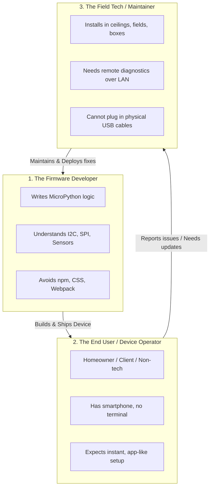

# `espmpui` Value Proposition & User Personas

> **The North Star:** Deliver a modern, reactive, app-like Web UI for microcontrollers in under 15 lines of code — using < 5 KB flash, < 8 KB RAM, and requiring zero frontend build tooling.

---

## 1. Why Value Clarity Matters

In embedded software, projects easily fall into two failure modes:
1. **Under-engineering (The "Bare Minimum" Trap):** Serving raw, unstyled HTML forms that require page refreshes, look primitive, provide no live feedback, and break on the first network hiccup.
2. **Over-engineering (The "Full-Stack Bloat" Trap):** Importing complex web frameworks (React, Webpack, Tailwind), blowing past the microcontroller's RAM limits, introducing hundreds of `node_modules` dependencies, and requiring firmware developers to become frontend engineers.

`espmpui` strictly focuses on **real-world value** across the complete lifecycle of a physical device.

---

## 2. The Three Core Personas

Every feature built in `espmpui` must directly serve at least one of these three distinct personas:

---

### Persona 1: The Firmware Developer (You / Library Consumer)

* **Profile:** Embedded software engineer, IoT product creator, maker, or academic researcher writing MicroPython code on ESP32, ESP32-S3/C3, or Raspberry Pi Pico W.
* **Their Voice:**
  > *"I know hardware, registers, I2C buses, and sensors. I don't want to spend two weeks setting up Node.js, learning CSS flexbox, or writing WebSocket state synchronizers just to display a few sensor readings and a toggle switch on a browser."*
* **Their Core Frustrations:**
  - Embedded web servers that take 200 lines of boilerplate C++/Python just to handle basic routes.
  - Frontends that crash the microcontroller due to heap fragmentation or unhandled callback exceptions.
  - Maintaining separate web codebases alongside firmware code.
* **What `espmpui` Gives Them:**
  - **15 Lines of Clean Python:** Declare widgets (`app.tab()`, `tab.slider()`, `tab.switch()`) directly in firmware code.
  - **Zero Frontend Tooling:** Pre-compiled, pre-gzipped bundle (~4.7 KB) embedded directly into flash. No `npm`, no build step.
  - **Fault-Isolated Callbacks:** Exceptions in user button or slider handlers are trapped and reported to console/toast without crashing the main loop or rebooting the MCU.

---

### Persona 2: The End User / Device Operator (The Non-Technical User)

* **Profile:** Homeowner, client, office worker, or factory operator interacting with the physical gadget (smart thermostat, environmental monitor, automated feeder, lab instrument).
* **Their Voice:**
  > *"I don't know what an IP address like `192.168.4.1` is. I don't have a terminal or USB cable. If I change a temperature threshold and unplug the device, why does it forget everything when I plug it back in?"*
* **Their Core Frustrations:**
  - Being told to open a serial monitor or edit a `secrets.py` file to set up Wi-Fi.
  - Clunky web interfaces that feel like 1995 desktop websites on their smartphone.
  - Lost settings after sudden power cuts or accidental unplugging.
* **What `espmpui` Gives Them:**
  - **Captive Portal Provisioning:** Power the device on $\to$ phone auto-detects captive portal $\to$ tap home Wi-Fi and enter password. Setup completed in 30 seconds.
  - **Mobile-First Responsive UI:** Fast, fluid, touch-friendly dark/light controls that look and feel like an installed mobile application.
  - **Persistent Settings:** Changes to sliders and form inputs are saved atomically to flash and survive power outages.

---

### Persona 3: The Field Technician / Maintenance Integrator

* **Profile:** Technician, hardware installer, or system integrator responsible for keeping 10 to 1,000 deployed devices operating reliably in real-world environments.
* **Their Voice:**
  > *"This sensor is mounted 15 feet high in a waterproof enclosure on a greenhouse ceiling. I cannot climb a ladder with a laptop and FTDI serial cable just to see why it disconnected or to flash a bug fix."*
* **Their Core Frustrations:**
  - Devices that silently freeze or drop off Wi-Fi with no diagnostic visibility.
  - Having to physically unmount hardware with screwdrivers just to flash a firmware update.
  - Disassembling waterproof enclosures, destroying seals and gaskets for routine maintenance.
* **What `espmpui` Gives Them:**
  - **Live Diagnostics Tab:** Open any browser on the local network to view live heap memory, GC collection activity, Wi-Fi signal strength (RSSI), and uptime.
  - **Drag-and-Drop Web OTA Updater:** Flash new firmware `.bin` or filesystem images over Wi-Fi with upload progress and automatic post-reboot reconnect.

---

## 3. Feature-to-Persona Value Mapping Matrix

Every feature in our roadmap must justify its existence through this matrix:

| Feature / Module | Target Persona(s) | Operational Lifecycle | Tangible Value Delivered |
| :--- | :--- | :--- | :--- |
| **Declarative Widget API** | **Developer** | Development & Prototyping | Cuts dashboard creation from 2 weeks to 20 minutes with zero frontend tooling. |
| **Fault-Isolated Event Loop** | **Developer & Technician** | Continuous Runtime | Prevents buggy user callbacks from crashing the device or freezing background tasks. |
| **Wi-Fi Manager & Captive Portal** | **End User & Developer** | Initial Setup & Relocation | Eliminates hardcoded Wi-Fi credentials; enables seamless mobile onboarding. |
| **Persistent Config Store** | **End User & Developer** | Commissioning & Re-tuning | Atomic flash persistence ensures settings survive reboots and power outages. |
| **Live Diagnostics Tab** | **Technician & Developer** | Bench Testing & Field Maintenance | Remotely detects heap exhaustion and Wi-Fi drops without serial cable access. |
| **Web-Based OTA Updater** | **Technician & End User** | Long-term Maintenance | Enables wireless bug fixes and feature updates on sealed/inaccessible hardware. |

---

## 4. User Journey: Before vs. After `espmpui`

### Journey 1: Setting Up Wi-Fi on a New Device

| Step | Traditional Embedded Approach (Before) | `espmpui` Experience (After) |
| :--- | :--- | :--- |
| **1. Power On** | Device fails to connect; blinks red LED or does nothing. | Device starts SoftAP (`espmpui-setup`) and launches background DNS responder. |
| **2. Discovery** | User must plug in USB, open serial monitor at 115200 baud to read instructions. | User’s smartphone notifies: *"Sign in to Wi-Fi network 'espmpui-setup'"*. |
| **3. Interface** | User must manually open a browser and type `192.168.4.1` into the address bar. | Captive portal opens automatically in full-screen modal. |
| **4. Credentials** | User must manually type network name (error-prone). | User selects their SSID from a scanned list with signal bars, enters password. |
| **5. Verification** | Device reboots blind; if password was wrong, device is unreachable. | Device tests connection in background; reboots only upon verified connection. |

---

### Journey 2: Diagnosing an Unstable Field Node

| Step | Traditional Embedded Approach (Before) | `espmpui` Experience (After) |
| :--- | :--- | :--- |
| **1. Symptom** | Sensor stops sending readings once every 3 days. | Sensor stops sending readings once every 3 days. |
| **2. Inspection** | Tech climbs ladder, unscrews IP67 waterproof case, connects USB serial cable. | Tech connects laptop to local Wi-Fi, navigates to `http://sensor-node.local/`. |
| **3. Diagnosis** | Tries to catch debug logs in terminal; requires reproducing the crash on bench. | Opens **Diagnostics Tab**: sees free heap steadily dropping by 2 KB/hour (memory leak identified). |
| **4. Resolution** | Takes board back to lab, re-flashes with USB cable, climbs ladder to re-mount. | Drags patched `.bin` into **OTA Updater**; board updates, verifies, and reboots in 45 seconds. |

---

## 5. The "Value Gate": Rules for Accepting New Features

To prevent feature creep and bloat, any proposed feature must pass these three rules:

1. **Rule of Microcontroller Reality:** Does this feature fit within 5 KB flash and 8 KB heap without causing RAM fragmentation? If no, it is rejected.
2. **Rule of Direct Persona Value:** Does this feature clearly save the Developer time, simplify the End User experience, or empower the Field Technician? If it only satisfies academic curiosity (e.g. theoretical binary protocol benchmarks), it is deprioritized.
3. **Rule of Zero-Tooling:** Does using this feature force the firmware developer to install Node.js, Webpack, or external build toolchains? If yes, it violates our core promise.
