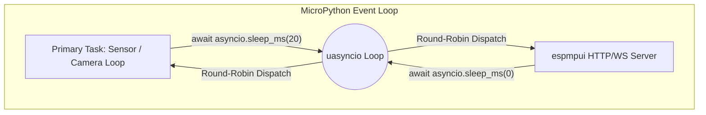
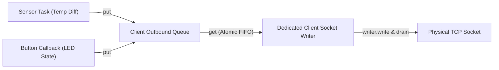

# `espmpui` Concurrency, Non-Blocking Architecture & Fault Isolation Specification

## 1. The MicroPython Concurrency Model

MicroPython runs on a **single-threaded cooperative event loop** (`uasyncio`).
Tasks in MicroPython are not preempted by an OS kernel. This establishes a key constraint:

> **If any coroutine blocks for an extended duration, other coroutines cannot execute until it yields.**
> Long blocking operations can impact sensor acquisition, motor control timing, or watchdog resets.

To help `espmpui` operate smoothly alongside primary hardware routines, the framework is designed around five core principles:
1. **Cooperative Yield Slicing**
2. **Backpressure & Bounded Dropping Policies**
3. **Fault Barrier Isolation**
4. **Outbound Frame Serialization**
5. **ISR-to-Async Bridge Safety**

---

## 2. Principle 1: Non-Blocking Execution & Cooperative Yielding



### 2.1. Chunked Streaming with Explicit Cooperative Yields
Serving a static web asset or camera frame over HTTP should avoid monopolizing the event loop:
* Payloads are sliced into **512-byte or 1024-byte chunks**.
* After each chunk write and `await writer.drain()`, `espmpui` explicitly yields:
  ```python
  await writer.drain()
  await asyncio.sleep_ms(0)  # Yield to give other coroutines execution time
  ```
* This provides regular opportunities for other queued coroutines to run during asset transmission.

### 2.2. Minimizing Large Dynamic Allocations
* MicroPython's Garbage Collector (`gc.collect()`) runs a mark-and-sweep cycle when heap memory is constrained.
* Assembling large strings or buffers dynamically can trigger garbage collection cycles that pause execution.
* `espmpui` is designed to mitigate this by:
  1. Serving pre-compressed `.gz` bytes directly from flash or frozen byte arrays.
  2. Formatting diff packets with compact single-line JSON templates (average size < 40 bytes).
  3. Supporting an optional idle GC cleaner (`gc.collect()` scheduled during idle periods) to help reduce the likelihood of uncoordinated GC sweeps during active hardware operations.

---

## 3. Principle 2: Backpressure & Telemetry Dropping Policy

When a connected client experiences network latency, drops Wi-Fi, or locks its screen:
* If the ESP32 sensor loop publishes telemetry frequently, outbound message queues could otherwise accumulate in RAM.
* If socket writes were blocking, the sensor loop could stall waiting for socket buffers to drain.

### The "Latest-State-Wins" Policy:
* Each connected client has an outbound queue with a **fixed maximum depth (e.g., 8 messages)**.
* For telemetry and sensor diffs (`op: "set"`), if the client's queue is full, **older unconsumed frames are dropped**:
  ```python
  def push_telemetry(self, client, diff):
      try:
          client.out_queue.put_nowait(diff)
      except QueueFull:
          # Drop older sample, keep primary task running without stalling
          client.out_queue.get_nowait()
          client.out_queue.put_nowait(diff)
  ```
* **Result**: The sensor loop can continue queueing updates without waiting on stalled clients, queue size remains bounded, and clients receive the most recent value upon catching up.

---

## 4. Principle 3: Fault Isolation & Error Handling

### 4.1. Callback Exception Guard
If a callback raises an unexpected exception:
```python
def on_button_click(widget):
    res = 10 / 0  # ZeroDivisionError!
```
An unhandled exception inside an async task could terminate the server coroutine. To prevent this, `espmpui` wraps callback dispatches in an exception handler:
```python
async def _safe_dispatch(self, callback, widget, value):
    try:
        if is_coroutine_function(callback):
            await callback(widget, value)
        else:
            callback(widget, value)
    except Exception as exc:
        # 1. Log traceback to serial console
        sys.print_exception(exc)
        # 2. Push non-intrusive diagnostic error toast to browser
        await self._broadcast_toast(f"Callback error in {widget.id}: {exc}", level="error")
        # 3. Other coroutines and the server continue running
```

### 4.2. Connection Disconnections & Reset Handling
Microcontrollers frequently encounter client disconnections or network drops.
* `espmpui` wraps socket reads and writes in `OSError` handlers.
* Catching disconnection errors (`ECONNRESET`, `EPIPE`, `ETIMEDOUT`, `ENOTCONN`) triggers clean tear-down:
  1. Remove client reference from `app.clients` set.
  2. Cancel client's background write task.
  3. Close socket stream.
  4. Perform cleanup without raising uncaught exceptions into the main loop.

### 4.3. Hardware Watchdog (WDT) Interaction
Because network operations yield cooperatively, the application can continue feeding `machine.WDT` periodically from its own tasks.

---

## 5. Principle 4: Concurrency & Reentrancy Controls

### 5.1. WebSocket Frame Serialization (Write Lock)
If two independent coroutines (e.g., a background temperature monitor and a user button response) attempt to write to the same WebSocket client concurrently, raw socket writes can interleave bytes, corrupting the WebSocket frame header.

**Solution**: Each client maintains a dedicated, serialized writer task fed by an `asyncio.Queue`, ensuring that each WebSocket frame is written atomically and in sequence.



### 5.2. Action Debouncing & Busy Rejection
If a user rapidly taps a button or drags a slider aggressively:
* Without protection, multiple callback tasks can spawn simultaneously, potentially overwhelming hardware I/O (e.g., rapid relay switching or multiple I2C transactions).
* `espmpui` provides optional widget-level protection:
  - `debounce_ms`: Ignores rapid taps within $N$ milliseconds.
  - `busy_policy="drop"`: If an async callback is still executing, subsequent triggers are ignored until the first finishes.
  - `busy_policy="queue"`: Queues only the latest event.

### 5.3. Hardware Mutex / Shared Bus Protection
For shared buses (I2C, SPI) or cameras, applications can coordinate access with an asyncio lock:
```python
# User can pass a lock to widgets or wrap hardware interactions:
hw_lock = asyncio.Lock()

async def read_i2c_sensor(widget):
    async with hw_lock:
        return sensor.read()
```

---

## 6. Principle 5: Interrupt Service Routine (ISR) to Async Bridge

MicroPython hardware interrupts (e.g., `pin.irq(...)`) execute in a hard interrupt context where:
* Heap memory cannot be allocated (`MemoryError`).
* Coroutines cannot be awaited or scheduled directly.

If a physical button press or sensor alert on GPIO needs to update an `espmpui` widget, `espmpui` provides `widget.schedule_value(val)`:
```python
def gpio_isr_handler(pin):
    # Safe to call from hard ISR!
    # Uses micropython.schedule() to defer into main thread,
    # which then queues the WebSocket broadcast.
    alarm_widget.schedule_value("TRIPPED")

pir_pin.irq(trigger=Pin.IRQ_RISING, handler=gpio_isr_handler)
```

---

## 7. Principle 6: Flash Persistence & Atomic Brownout Recovery

Microcontrollers frequently experience unexpected power brownouts or watchdog resets:
* Naive file writes (`open('config.json', 'w')`) truncate the file to 0 bytes upon opening. A power cut during the write destroys all saved parameters.
* `espmpui.ConfigStore` prevents corruption by writing to a temporary file first (`config.json.tmp`), executing `f.flush()` and `os.sync()`, and then executing an atomic inode switch (`os.rename`).
* On boot, if `config.json` is missing or truncated, `ConfigStore` automatically checks for and recovers from `.tmp`, guaranteeing parameter integrity under all power failure scenarios.

---

## 8. Principle 7: Streaming Multipart OTA Under Strict RAM Budgets

Firmware binaries are typically 1 MB to 3 MB, while an ESP32 in MicroPython often has only 100 KB–200 KB free heap:
* Traditional web handlers that buffer request bodies in memory (`await reader.read()`) cause immediate Out-Of-Memory crashes.
* `espmpui.OTAHandler` implements a **sliding-window streaming parser** that reads chunks in 512-byte slices directly from the socket into flash partitions (`esp32.Partition`).
* The RAM buffer peak remains strictly **under 4 KB** throughout a multi-megabyte firmware upload.
* An incremental SHA-256 digest is computed on the fly, and `partition.set_boot()` is only invoked if the full binary stream was completed with a non-zero payload, preventing half-written corrupted boot states.

---

## 9. Summary of Concurrency & Reliability Practices

| Area | Challenge / Consideration | `espmpui` Approach |
| :--- | :--- | :--- |
| **Asset Download** | Monopolizing CPU during file transfer | Streams in small (512B–1KB) chunks with explicit `sleep_ms(0)` yields |
| **GC Pressure** | Dynamic allocations triggering uncoordinated GC pauses | Serves pre-compressed assets from flash; uses small JSON diffs |
| **Slow Wi-Fi Client** | Buffer bloat from unresponsive clients | Bounded queue with latest-state-wins drop policy |
| **Callback Exceptions** | Uncaught exceptions terminating server coroutine | Dispatches wrapped in try/except; logs error and alerts UI |
| **Client Disconnect** | Network drops raising unhandled socket errors | Clean socket teardown and client removal from registry |
| **Rapid Button Taps** | Rapid repeated triggers overwhelming I/O | Optional debounce intervals and busy rejection |
| **Concurrent Task Writes** | Interleaved writes corrupting WebSocket frames | Dedicated FIFO serialization task per client |
| **Hardware Interrupts** | Heap allocation forbidden in hard ISR | Defers event handling via `micropython.schedule()` |
| **Power Brownouts** | Flash file truncation on sudden power cut | Atomic write-temp and inode rename (`config.tmp` $\to$ `config.json`) |
| **OTA Firmware Upload** | 1–3 MB binary causing RAM Out-Of-Memory crash | 512B sliding window parser streaming directly to flash (<4 KB peak RAM) |
